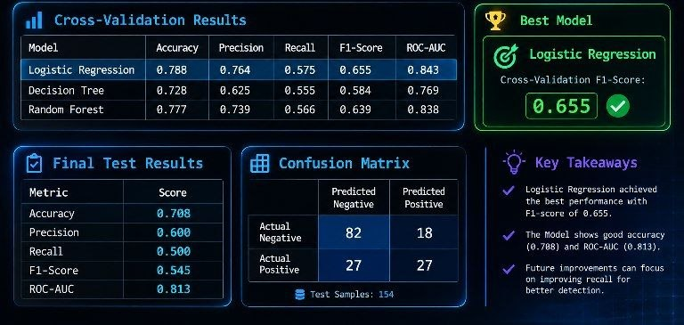

Diabetes Prediction Using Machine Learning

  A Machine Learning Classification Project

---

About The Project

This project focuses on predicting diabetes using machine learning classification algorithms.

It follows a complete machine learning workflow, including data preprocessing, model training, cross-validation, model comparison, and performance evaluation.

The main objective is to compare different classification algorithms and select the best-performing model based on cross-validation results.

Machine Learning Models

Three classification algorithms are implemented:

- Logistic Regression
- Decision Tree Classifier
- Random Forest Classifier

Project Workflow

1. Data Loading and Exploration
2. Data Quality Inspection
3. Handling Missing and Invalid Values
4. Feature and Target Separation
5. Train-Test Split
6. Data Preprocessing Using Pipelines
7. Stratified 5-Fold Cross-Validation
8. Model Training
9. Model Performance Comparison
10. Overfitting Analysis
11. Best Model Selection
12. Final Model Evaluation
13. Confusion Matrix Analysis
14. Classification Report
15. Model Saving and Loading
16. Prediction on New Data

Technologies Used

- Python
- Pandas
- Scikit-learn
- Joblib

Evaluation Metrics

The models are evaluated using:

- Accuracy
- Precision
- Recall
- F1-Score
- ROC-AUC
- Confusion Matrix

Project Structure

diabetes-prediction-ml/
│
├── src/
│   └── train.py
│
├── data/
├── models/
│
├── requirements.txt
├── README.md
└── .gitignore

Installation

Clone this repository:

git clone https://github.com/ASdwd31224/diabetes-prediction-ml.git

Navigate to the project directory:

cd diabetes-prediction-ml

Install the required libraries:

pip install -r requirements.txt

Place the dataset in the "data" directory and run:

python src/train.py

## Results

### Cross-Validation Results

| Model | Accuracy | Precision | Recall | F1-Score | ROC-AUC |
|---|---:|---:|---:|---:|---:|
| Logistic Regression | 0.788 | 0.764 | 0.575 | 0.655 | 0.843 |
| Decision Tree | 0.728 | 0.625 | 0.555 | 0.584 | 0.769 |
| Random Forest | 0.777 | 0.739 | 0.566 | 0.639 | 0.838 |

### Best Model

Logistic Regression

Cross-Validation F1-Score: 0.655

### Final Test Results

| Metric | Score |
|---|---:|
| Accuracy | 0.708 |
| Precision | 0.600 |
| Recall | 0.500 |
| F1-Score | 0.545 |
| ROC-AUC | 0.813 |

### Confusion Matrix

| | Predicted Negative | Predicted Positive |
|---|---:|---:|
| Actual Negative | 82 | 18 |
| Actual Positive | 27 | 27 |

The model was evaluated on 154 test samples.

Future Improvements

- Hyperparameter Optimization
- Feature Importance Analysis
- Additional Machine Learning Models
- Model Interpretability
- Improved Prediction Performance

Disclaimer

This project is intended for educational and research purposes only. It is not a medical diagnostic tool and should not be used to make healthcare decisions.

---

Developed by ASdwd31224
